## Trend Chart Mendix Pluggable Widget
A Mendix widget to show trend charts based on https://github.com/unsplash/react-trend. 

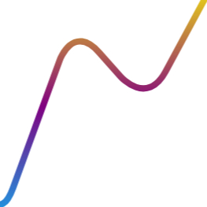

Quoting the [Unsplash's README](https://github.com/unsplash/react-trend?tab=readme-ov-file#react-trend), "Graphing tools are often complex, abstract, and heavy. They require domain-specific knowledge, and a significant time investment. But what if you just need a spark line that shows a trend? (...) These are very simple and elegant visualizations, and they should not require a bloated graphing library to produce."

Now, it is possible to easily build these simple trend graphs (similar to the ones shown by Github, for instance) in your Mendix application.

## Features
Easily show trending charts. Every option of react-trend is available, in a small built-in rewrite of the library with no extra dependencies:

*   **Data:** any list data source, with a Decimal, Integer or Long attribute. Empty values are skipped.
*   **Color:** a solid line color (any CSS color, or the current text color when empty), a vertical gradient of two or more colors, and the line opacity.
*   **Size:** width, height and padding. Leave width and height at 0 to fill the container at a 1:4 ratio.
*   **Auto draw:** enable, duration, easing (any CSS timing function), and redraw on data change.
*   **Stroke:** width, line cap, line join and dash pattern.
*   **Smoothing:** smooth and radius.
*   **Accessibility:** a description that screen readers announce; without it the line is hidden from screen readers.
*   **Studio Pro:** a design mode preview of the line, and properties that hide when they have no effect.

## Requirements
*   Mendix 11 or newer (the widget is built with the Mendix 11 widget tools and React 19). Use version 1.0.x on earlier Mendix versions.
*   Version 1.1.0 changes how values are read; see the [CHANGELOG](CHANGELOG.md) before upgrading.

## Usage
Feel free to check the [demo (.mpk)](https://github.com/StoneworxNL/react-trend-mendix/tree/main/demo) for a better understanding.

1. Add the Trend widget to a page. Since version 1.1.0 it does not need a data view.
2. Set its data source (database, microflow, nanoflow, or an association inside a data view) and the attribute that holds the values.
3. Customize it.

### Configuration Screenshots

#### Toolbox
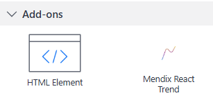

#### Page Setup
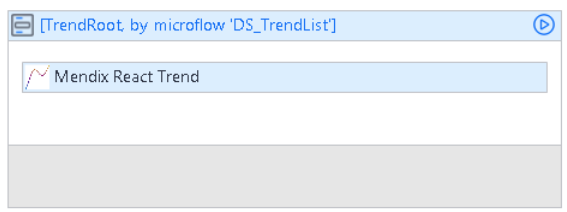

#### Domain Model (Demo)
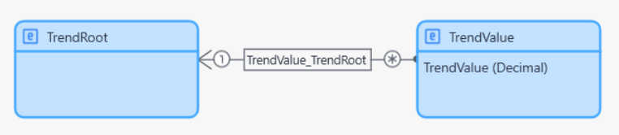

### Properties

| Tab | Property | What it does |
| --- | --- | --- |
| General | Trend list, Trend value | The list data source and the Decimal, Integer or Long attribute with the values. |
| General | Line color | Any CSS color. Empty uses the current text color. Hidden when a gradient is set. |
| General | Gradient | Two or more colors for a vertical gradient, bottom to top. |
| General | Opacity | Line opacity, from 0 to 1. |
| General | Width, Height, Padding | Fixed size in pixels (0 fills the container at 1:4) and room around thick lines. |
| Auto draw | Enable, Duration, Easing | Let the line draw itself, with any CSS timing function. |
| Auto draw | Redraw on data change | Play the animation again when the data changes. |
| Stroke/Smoothing | Stroke width, Line cap, Line join, Dash pattern | The look of the line. |
| Stroke/Smoothing | Smooth, Radius | Round the peaks, from subtle to snake-like. |
| Accessibility | Description | Text for screen readers. Empty hides the chart from them. |

## Demo Project
- [Mendix app running on the cloud](https://reacttrend-sandbox.mxapps.io/index.html)
- [Mendix demo module (.mpk)](https://github.com/StoneworxNL/react-trend-mendix/tree/main/demo)

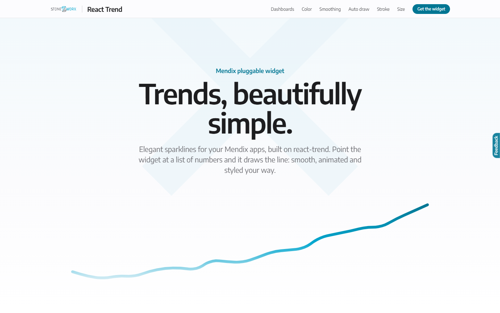

| | |
| --- | --- |
| 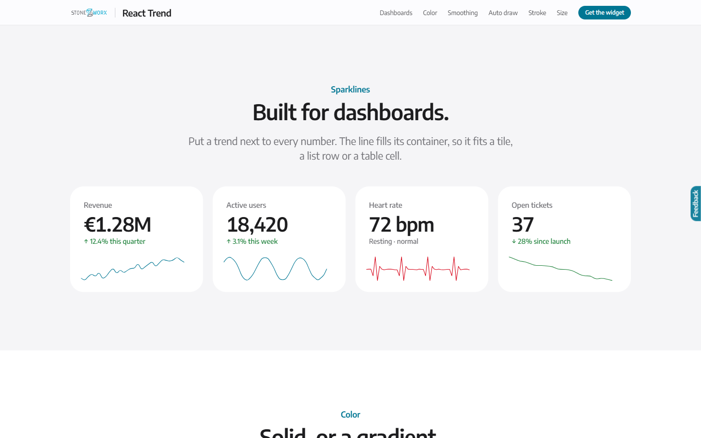 | 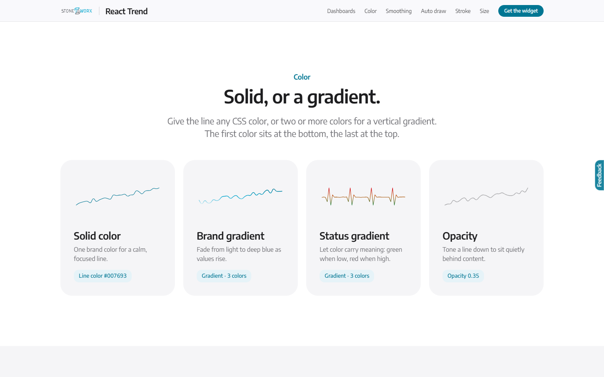 |
| 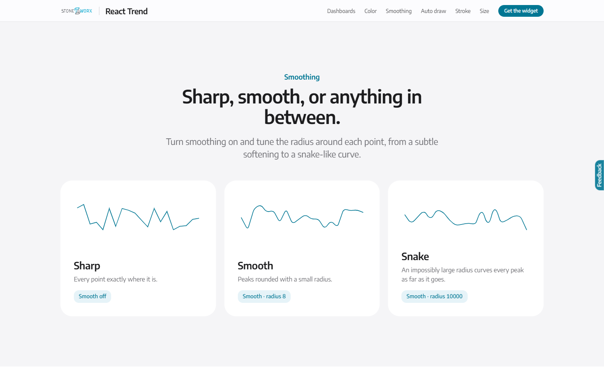 | 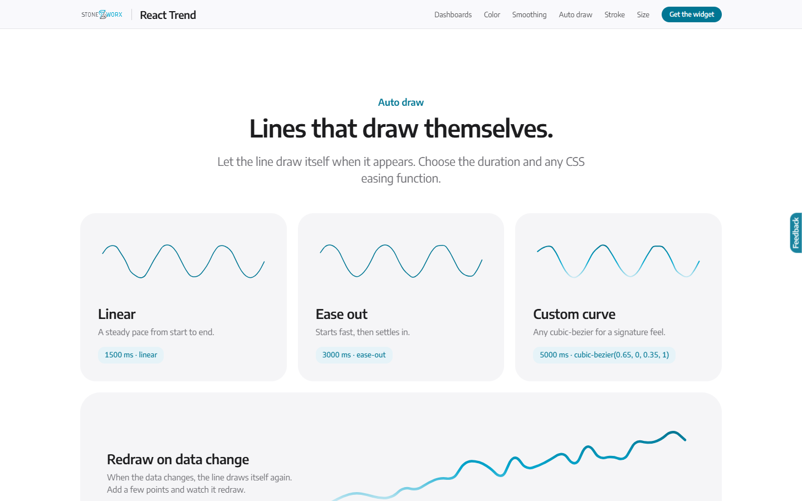 |
| 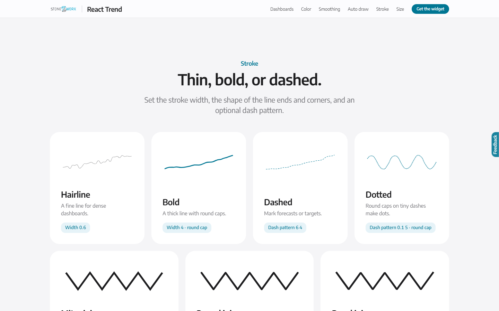 | 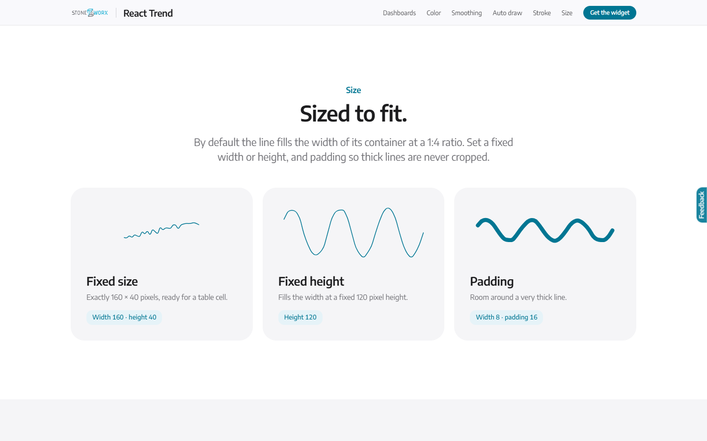 |

Full page and phone screenshots

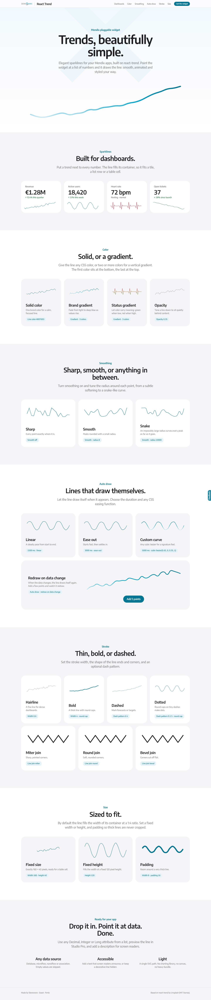
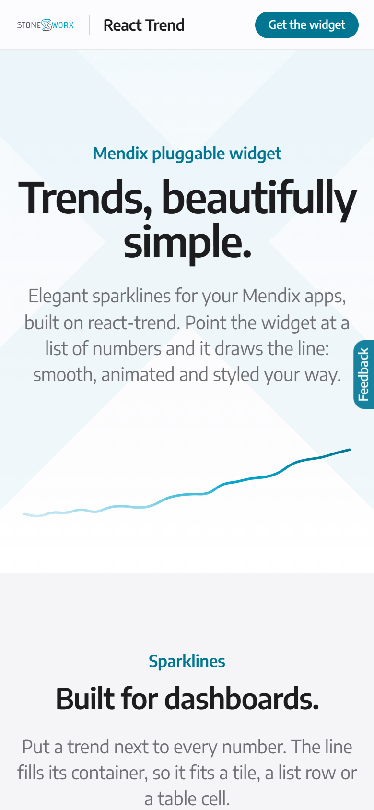

<!-- - [Marketplace widget](https://marketplace.mendix.com/link/component/237438) -->

## Issues, Suggestions and Feature Requests

*   No known issues at the moment. If you have improvement suggestions, feel free to contact us.

<!-- ## About Stoneworx

We started our company as friends and will always remain a club of people that likes doing business in a friendly matter. A group of entrepreneurial, smart and highly experienced Mendix professionals.  

On a daily basis, we create software applications that simplify our clients’ business processes by using the Mendix low code platform. It is our mission is to turn complex ideas into simple solutions for medium to corporate-sized businesses, in any industry. -->